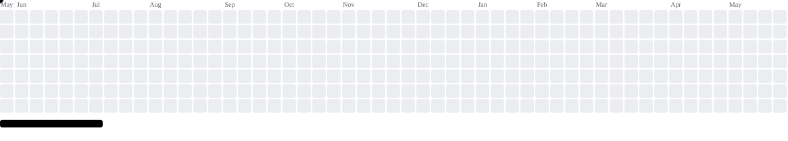
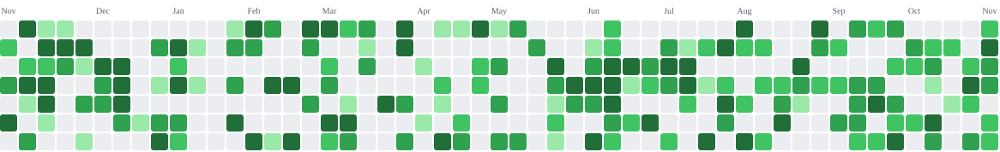

### 💫 About Me:
HEY, I'm BOO I work as a ~web designer~ front-end developer with UI/UX design skills (front-end designer). I´m based in Egypt, Cairo. I love programming, Reading and sport I enjoy using my obsessive attention to detail I love learning new technologies and contributing to open source.   

## 🌐 Socials:
   

# 💻 Tech Stack:
               	 
# 📊 GitHub Stats:
 
 

## 🏆 GitHub Trophies

### ✍️ Random Dev Quote

---

### Pac-Man preview

<picture>
    <source media="(prefers-color-scheme: dark)" srcset="assets/demo/pacman-dark.svg">
    <source media="(prefers-color-scheme: light)" srcset="assets/demo/pacman.svg">
    
</picture>

### Breakout preview

<picture>
    <source media="(prefers-color-scheme: dark)" srcset="assets/demo/breakout-dark.svg">
    <source media="(prefers-color-scheme: light)" srcset="assets/demo/breakout.svg">
    
</picture>

### Galaga preview

<picture>
    
</picture>

### Puzzle Bobble preview

<picture>
    <source media="(prefers-color-scheme: dark)" srcset="assets/demo/puzzle-bobble-dark.svg">
    <source media="(prefers-color-scheme: light)" srcset="assets/demo/puzzle-bobble.svg">
    
</picture>

### Bomberman preview

<picture>
    <source media="(prefers-color-scheme: dark)" srcset="assets/demo/bomberman-dark.svg">
    <source media="(prefers-color-scheme: light)" srcset="assets/demo/bomberman.svg">
    
</picture>

### Minesweeper preview

<picture>
    <source media="(prefers-color-scheme: dark)" srcset="assets/demo/minesweeper-dark.svg">
    <source media="(prefers-color-scheme: light)" srcset="assets/demo/minesweeper.svg">
    
</picture>

### Snake preview

<picture>
    <source media="(prefers-color-scheme: dark)" srcset="assets/demo/snake-dark.svg">
    <source media="(prefers-color-scheme: light)" srcset="assets/demo/snake.svg">
    
</picture>

### Tetris preview

<picture>
    <source media="(prefers-color-scheme: dark)" srcset="assets/demo/tetris-dark.svg">
    <source media="(prefers-color-scheme: light)" srcset="assets/demo/tetris.svg">
    
</picture>
